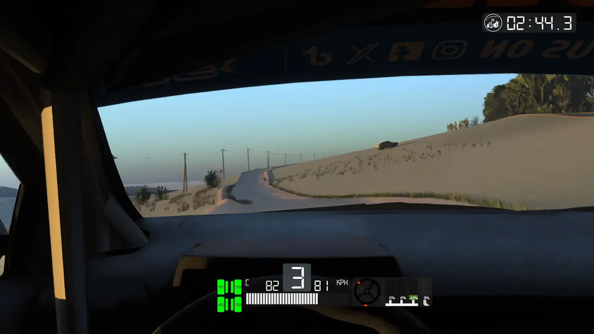

<h1 align="center">Richard Burns Rally - RTX Remix Compatibility Mod</h1>

Path tracing for **Richard Burns Rally + RallySimFans (RSF)**, with real sun, sky, weather and wet roads, through
[Remix Plus](https://github.com/RemixProjGroup/dxvk-remix), the community fork of NVIDIA's [RTX Remix](https://github.com/NVIDIAGameWorks/rtx-remix).

**This is not a remaster.** The stages, cars and physics are the game's own. The mod only adds files, and it uninstalls cleanly.

**Work in progress: expect issues, and please [report them](docs/troubleshooting.md).**

## What it does

- **Path tracing on the original game.** RBR draws everything with vertex shaders, which Remix cannot place in 3D. The mod rebuilds camera and object positions from the game's shader data and hands them to Remix.
- **Sun, sky and weather.** The NUMOS sky follows each stage's sun, weather and time of day: real clouds, fog and haze, and a main menu whose weather slowly changes.
- **Wet roads.** Damp and wet tracks darken the road and fill its hollows with puddles, and rain leaves ripples and raindrop rings.
- **Particles.** Dust takes the colour of the ground, and tarmac smokes under a slide. Rain, snow and windscreen drops are real particles, lit by the sun and sky.
- **Dynamic lights.** Headlights by car year in real candela, brake and reversing lights, hot brake discs, backfire flashes and street lamps.
- **An in-game menu.** **F3** has wetness sliders, a texture tagger, custom lights, car paint and per-stage atmosphere.
- **Reporting tools.** Every stage you drive is logged and zipped locally. Nothing is sent anywhere.
- **A pure add-on.** It adds `d3d9.dll` and an `rbr-rtx\` folder. No game file is changed.

## Requirements

| | |
|---|---|
| **GPU** | NVIDIA RTX card (20-series or newer) with a current driver |
| **Game** | Richard Burns Rally with the RallySimFans launcher, **Graphics mode = Normal** (the Vulkan, dgVoodoo and VR modes bring their own `d3d9.dll`) |
| **Must NOT be installed** | **ReShade** and the **RBR Lights Plugin**. With either one in the game, Remix will not run properly. |

## Installation

1. Download the latest [release](https://github.com/penkaty/RBR-RTX/releases) (`.7z` opens with [7-Zip](https://www.7-zip.org/)) and unpack it **into your RBR folder**, next to `RichardBurnsRally_SSE.exe`.
2. RSF launcher settings: **Cubic env maps off**, **Render car shadows off**, **Particles off**.
3. Start the game. The first start compiles shaders and takes longer.

**Updating from 0.3 or older:** read [Installation](docs/installation.md) first. Old saved settings override the new defaults.
**Uninstall:** run `rbr-rtx\uninstall.cmd`. It removes everything RBR-RTX added.

## The keys worth knowing

You need none of these to drive. [All keys](docs/keybinds.md) can be changed in `rbr-rtx\config\keys.ini`.

| Key | What it does |
|---|---|
| **F3** | In-game menu |
| **Alt+X** | Remix's own menu |
| **L** | Headlights: off, two lamps, brights |
| **0** | Ray tracing on/off, to compare with the original picture |
| **9** | Mark a problem while driving |
| **Alt+K** | Stage sweep for bug reports: hold still until the beep |

## Help wanted

RBR bakes each stage's light into the scenery, so the path-traced sun and weather have to agree with the bake, stage by stage. **Only a player looking at the stage can tell when they do not.** Every stage you set right is fixed for all players in the next release.

- **A sky that blocks the sun:** flag the texture as a sky texture in **Alt+X** and tell me the stage.
- **A sun in the wrong place:** it takes under 20 seconds, see [Fixing the sun](docs/fixing-the-sun.md).
- **A bug:** run **Alt+K** on the spot and send the report, see [Troubleshooting](docs/troubleshooting.md).

**Work in progress:** unusual weather, rare stages and Bob's Track Builder stages can look wrong. See [Known issues](docs/known-issues.md).

## Documentation

| Page | Contents |
|---|---|
| [Installation](docs/installation.md) | Step by step, updating, uninstalling, RSF launcher settings |
| [Keybinds](docs/keybinds.md) | Every key |
| [Particles, rain, snow and weather](docs/particles-and-weather.md) | What the settings do and how to change them |
| [Fixing the sun](docs/fixing-the-sun.md) | Set a stage's sun and send it in |
| [Troubleshooting](docs/troubleshooting.md) | Black picture, low FPS, crashes, how to report a problem |
| [Known issues](docs/known-issues.md) | What is not working yet |
| [Remix settings for strong PCs](docs/remix-settings.md) | Raise the quality if your GPU has headroom |
| [0.4.0 technical notes](docs/release-0.4.0.md) | How it works, what we found, runtime options |
| [Changelog](CHANGELOG.md) | What changed in each version, and why |
| [Contributing](CONTRIBUTING.md) | Reports, sun fixes, code, building from source |

<b>Credits</b>

- [Kim2091](https://github.com/Kim2091) (sparkles): **Remix Plus** ([RemixProjGroup/dxvk-remix](https://github.com/RemixProjGroup/dxvk-remix)),
  the [NUMOS](https://github.com/Kim2091/numos-sky) sky, clouds, weather and fog, and the runtime branch this mod's renderer is
  built on ([Kim2091/dxvk-remix](https://github.com/Kim2091/dxvk-remix) `fnv/main`: 32-bit bridge API forwarding, retained
  instances, terrain layers, D3D9 texture import), shown working in [New Vegas RTX](https://github.com/Kim2091/New-Vegas-RTX).
  Much of what this mod does depends on Kim's work. Also [PBRify_Remix](https://github.com/Kim2091/PBRify_Remix) (our PBR maps)
  and [Remix-Wrappers](https://github.com/Kim2091/Remix-Wrappers).
- [NVIDIA RTX Remix](https://github.com/NVIDIAGameWorks/rtx-remix): [dxvk-remix](https://github.com/NVIDIAGameWorks/dxvk-remix)
  runtime and Remix API header, [bridge-remix](https://github.com/NVIDIAGameWorks/bridge-remix).
- [xoxor4d](https://github.com/xoxor4d): the wetness and CardNormals work in our runtime; their compatibility mods are the blueprint for this one:
  [remix-comp-base](https://github.com/xoxor4d/remix-comp-base), [p2-rtx](https://github.com/xoxor4d/p2-rtx),
  [gta4-rtx](https://github.com/xoxor4d/gta4-rtx), [l4d2-rtx](https://github.com/xoxor4d/l4d2-rtx),
  [t4-rtx](https://github.com/xoxor4d/t4-rtx), [nfsc-rtx](https://github.com/xoxor4d/nfsc-rtx) (Remix injection fix),
  [remix-comp-projects](https://github.com/xoxor4d/remix-comp-projects), the [dxvk-remix fork](https://github.com/xoxor4d/dxvk-remix)
  and [AutoPBR](https://github.com/xoxor4d/gta4-rtx-autopbr-mod).
- [mika-n / NGPCarMenu](https://github.com/mika-n/NGPCarMenu): RBR memory layout (stage, car, weather).
- [Detegr / openRBRVR](https://github.com/Detegr/openRBRVR) and [dxvk-openRBRVR](https://github.com/Detegr/dxvk-openRBRVR): how RBR renders.
- [xxHash](https://github.com/Cyan4973/xxHash) (Yann Collet): texture hashes matching Remix's.
- [Dear ImGui](https://github.com/ocornut/imgui) (Omar Cornut, MIT, `src/d3d9-proxy/third_party/imgui/LICENSE.txt`): the F3 menu. Its hook
  into the game window and device follows the way xoxor4d's [remix-comp-base](https://github.com/xoxor4d/remix-comp-base) (MIT) does it.
- Other Remix mods studied: [Echelon Renderer](https://github.com/onnoj/DeusExEchelonRenderer) (onnoj),
  [D3D9DrvRTX](https://github.com/mmdanggg2/D3D9DrvRTX) (mmdanggg2), [Garry's Mod RTX Remixed](https://github.com/Xenthio/garrys-mod-rtx-remixed) (Xenthio),
  [Saints Row 3 RTX](https://github.com/PurrsianMilkman/Saints-Row-The-Third-RTX-REMIX-compatibility-mod) (PurrsianMilkman),
  gebdag's [Carmageddon 2](https://github.com/gebdag/carmageddon2-rtx-remix), [GTA2](https://github.com/gebdag/gta2-rtx-remix) and [Ignition](https://github.com/gebdag/ignition-rtx-remix),
  [Kenshi RTX](https://github.com/GARGEAN/Kenshi-RTX-Remix) (GARGEAN), [Thief Gold RTX](https://github.com/Night1099/thief-gold-rtx-remix) (Night1099),
  [RemixProjGroup dxvk-remix](https://github.com/RemixProjGroup/dxvk-remix), [Hooking-DX9-Present](https://github.com/bo3b/Hooking-DX9-Present) (bo3b)
- [RallySimFans](https://www.rallysimfans.hu/) for keeping RBR alive. Richard Burns Rally belongs to its owners;
  this mod contains none of its files.

## Licence

RBR-RTX is free and source-available under the [PolyForm Noncommercial License 1.0.0](LICENSE), for everything after version 0.3.0.
Versions up to 0.3.0 were released under MIT. You may use it, change it and share it for free. You may not sell it or any part of it:
no paid downloads, paywalls, paid or early-access tiers, paid installation, or bundling with anything paid. No commercial licence is offered.

**If you paid for this mod, you were scammed: please tell us.**

Third-party parts keep their own licences, see [THIRD-PARTY.md](THIRD-PARTY.md). The runtime in `rbr-rtx\remix` is not covered by this licence;
its source and licences are at [penkaty/dxvk-remix](https://github.com/penkaty/dxvk-remix). Not affiliated with or endorsed by NVIDIA.
