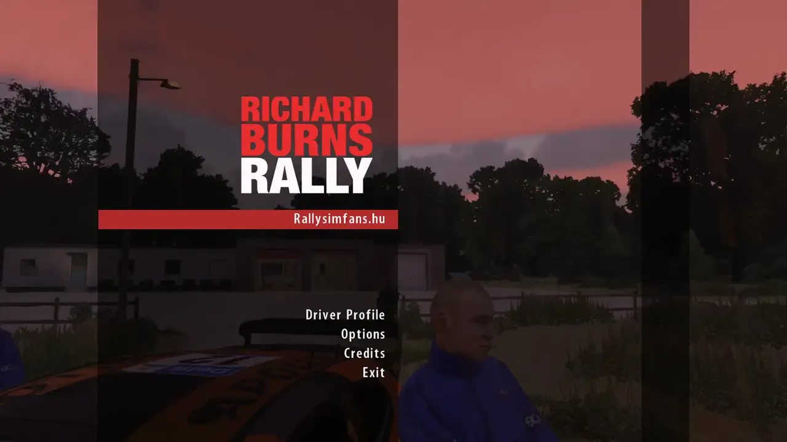
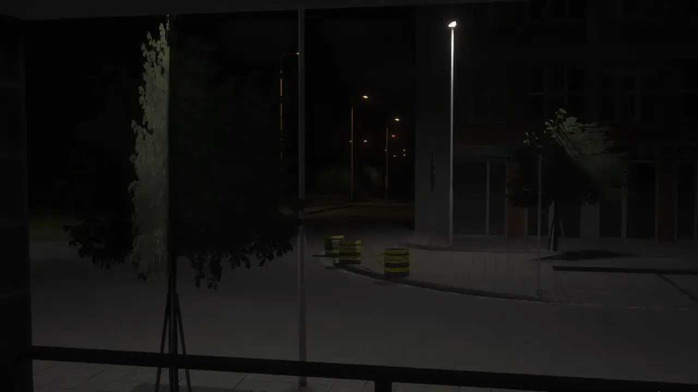

<h1 align="center">Richard Burns Rally - RTX Remix Compatibility Mod</h1>

Path tracing for **Richard Burns Rally + RallySimFans (RSF)**, through [Remix Plus](https://github.com/RemixProjGroup/dxvk-remix), the community fork by [Kim2091](https://www.patreon.com/cw/sparkles1), of NVIDIA's [RTX Remix](https://github.com/NVIDIAGameWorks/rtx-remix).

**This is not a remaster.** The mod only enables RTX Remix functionality within the game.

**Work in progress: expect issues, and please [report them](docs/troubleshooting.md).**

## What RBR-RTX brings to Richard Burns Rally

- **Path tracing on the original game.** RBR draws everything with vertex shaders, which Remix cannot place in 3D. The mod rebuilds camera and object positions from the game's shader data and hands them to Remix.
- **RTX Toolkit Blender workflow.** Allows stage creators to implement materials, high quality models and other modern rendering improvements into their stage creation workflow.
- **An in-game F3 menu.** Gives the user access to wetness sliders, a texture tagger, a lamp/emissive tool, headlight and per-stage atmosphere settings. Allowing simple work without the need to launch RTX Toolkit.
- **Sun, atmosphere and weather.** The NUMOS sky follows each stage's sun, weather and time of day: real clouds, fog, haze, a moon at night and lightning in heavy rain.
- **Dynamic puddles.** Damp and wet tracks darken, the road fills its indentations with puddles, with raindrops leaving ripples on their surface.
- **Simple experimental material system.** Gravel, tarmac, snow, grass, rock, wood and metal each get their own roughness, taken from what the game's physics says the surface is without the need of heavy PBR textures.
- **Particles.** Every effect the game has (dust, tyre smoke, water splashes, engine steam, rain, snow) is a real particle, lit by the sun, the sky and your headlights.
- **Dynamic lights.** Headlights by car year in real candela, tail, brake and reversing lights on the car's own lamp parts, glowing brake discs, backfire flashes, street lamps and lit windows at night.
- **Reporting tools.** Three keys (**8**, **9**, **Alt+K**) collect everything needed for a bug report. Nothing is sent anywhere.
- **A pure add-on.** It adds `d3d9.dll` and an `rbr-rtx\` folder. No game file is changed.

## Requirements

| | |
|---|---|
| **System** | Windows 10 or 11 |
| **GPU** | NVIDIA RTX card (20-series or newer) with driver **610.47 or newer**. For playable framerate at 1080p the minimum is RTX 2070/3060/4050 and RX 6700XT/7600XT and Arc A750/B570 |
| **AMD / Intel** | **Experimental**, not tested: a GPU with Vulkan ray tracing (Radeon RX 6000 or Intel Arc and newer). DLSS and Ray Reconstruction are NVIDIA only, so choose FSR or XeSS in the Alt+X menu. Expect a lower frame rate and some differences in the picture. |
| **Game** | Richard Burns Rally with a current RallySimFans install, **Graphics mode = Normal** (the Vulkan, dgVoodoo and VR modes bring their own `d3d9.dll`) |
| **Must NOT be installed** | **ReShade** and the **RBR Lights Plugin**. With either one in the game, Remix will not run properly. |

## Installation

1. Download the latest [release](https://github.com/penkaty/RBR-RTX/releases) (`.7z` opens with [7-Zip](https://www.7-zip.org/)) and unpack it **into your RBR folder**, next to `RichardBurnsRally_SSE.exe`.
2. Open the new `rbr-rtx` folder there and double-click **`install.bat`** (or run `install.ps1`).
3. RSF launcher: **Graphics mode = Normal, NOT Vulkan, NOT DgV DX11/DX12**. Keep **Particles on** if you want raindrops on the windscreen.
4. Start the game. The first start compiles shaders and takes longer.

**Updating from an older version:** read [Installation](docs/installation.md) first. Old saved settings override the new defaults.
**Uninstall:** double-click `rbr-rtx\uninstall.cmd`. It removes everything RBR-RTX added.

## The hotkeys worth knowing

[All keys](docs/keybinds.md) can be changed in `rbr-rtx\config\keys.ini`.

| Key | What it does |
|---|---|
| **F3** | In-game menu |
| **Alt+X** | Remix's own menu |
| **L** | Headlights: off, two lamps, brights |
| **0** | Ray tracing on/off, to compare with the original picture |
| **9** | Mark a problem while driving |
| **8** | Record everything drawn in one frame |
| **Alt+K** | Stage sweep for bug reports: hold still until the windows beep (2 minutes) |

## The F3 menu

**F3** opens RBR-RTX's own menu inside the game. The game keeps running behind it, and most pages work on whatever is under the crosshair in the middle of the screen. Stop the car first: the keyboard and mouse go to the menu, the steering wheel does not.

The full guide is in [The F3 menu](docs/f3-menu.md).

| Page | What you do there |
|---|---|
| **Info** | See the stage, weather, time and every hotkey |
| **Headlights** | Edit lamp brightness, colour, beam and the automatic switching |
| **Lamps** | Make a street lamp, floodlight or window glow and cast light, or place a free light anywhere |
| **Debug** | Switch single parts of the mod on and off to compare |
| **Save** | Write your values to `rbr-rtx\config\menu.ini` |

## Reporting a problem

Three keys do the logging. While you just drive, the mod only keeps a small report per stage; the detailed log starts when you ask for it. Nothing is sent anywhere.

| Key | Use it when | What you get |
|---|---|---|
| **9** | Something goes wrong while you drive | A beep, a screenshot and the frame times around that moment. The stage's report zip in `rbr-rtx\logs\reports` is kept and named `-marked`. It works in the main menu too. |
| **8** | One thing on screen is wrong right now (a lamp, a texture, a missing part) | Every draw of the next frame, written to `rbr-rtx\logs\rbrrtx_comp.log` |
| **Alt+K** | The whole picture or the frame rate is wrong | A sweep of about a minute that switches parts off one by one: screenshots, frame times per part, texture hashes and a Remix scene capture |

How to send them: [Troubleshooting](docs/troubleshooting.md).

## Documentation

| Page | Contents |
|---|---|
| [Installation](docs/installation.md) | Step by step, updating, uninstalling, RSF launcher settings |
| [Keybinds](docs/keybinds.md) | Every key |
| [The F3 menu](docs/f3-menu.md) | Every page of the in-game menu, with how-tos for lamps and texture tags |
| [How it works](docs/how-it-works.md) | NUMOS and every other system under the hood, in plain words |
| [Particles, rain, snow and weather](docs/particles-and-weather.md) | What the settings do and how to change them |
| [Fixing the sun](docs/fixing-the-sun.md) | Set a stage's sun and send it in |
| [Troubleshooting](docs/troubleshooting.md) | Black picture, low FPS, crashes, how to report a problem |
| [Known issues](docs/known-issues.md) | What is not working yet |
| [Remix settings for strong PCs](docs/remix-settings.md) | Raise the quality if your GPU has headroom |
| [0.4.0 technical notes](docs/release-0.4.0.md) | What we found and changed, runtime options |
| [Changelog](CHANGELOG.md) | What changed in each version, and why |
| [Contributing](CONTRIBUTING.md) | Reports, sun fixes, code, building from source |

### What runs under the hood

Since 0.4.0 the mod runs on Remix Plus, and that opened up systems the stock runtime did not have. Each one is explained in [How it works](docs/how-it-works.md).

| System | What it is |
|---|---|
| **Remix Plus** | The community runtime the mod is built on. Unlike stock Remix, its bridge lets a 32-bit game like RBR use the full Remix API, which everything below depends on. |
| **NUMOS** | Kim2091's physically based sky. It draws the atmosphere, sun, moon, volumetric clouds, fog and haze, and it lights the stage with them. RBR-RTX tells it the stage's sun, time and weather; NUMOS does the rest from a weather preset per RBR sky type. |
| **Remix API** | How RBR-RTX adds what the game never had: light sources, particle systems and meshes with real materials (lamp lenses, car glass, brake discs, the crew). |
| **Effects** | Every particle emitter of the game is replaced by a Remix particle system at the same place. |
| **Wetness** | xoxor4d's wet-surface shading: puddles, ripples, raindrop rings, darkening. RBR-RTX drives it from the stage's track condition and rain, and keeps puddles on the road with a mask from the game's physics. |
| **Material system** | Each ground texture gets its surface class from the game's physics, and each class has its own material. Lamps, foliage, car paint and gauges get materials generated while you play. |
| **Car and world lamps** | Lamp parts are learnt from each car model when a stage starts. Street lamps and windows come from textures marked in the F3 menu. |
| **Terrain baker, card normals** | Remix's ground blending for hand-tagged terrain, and xoxor4d's foliage shading for flat leaf cards. |
| **Radiance cache and Ray Reconstruction** | SHaRC for bounce light, RTXDI for direct light, DLSS Ray Reconstruction as the denoiser. |

**Still in progress:** unusual weather, some modern stages can look wrong, see [Known issues](docs/known-issues.md). Bob's Track Builder (BTB) stages are currently not supported.

<b>Credits</b>

- [Kim2091](https://github.com/Kim2091) (sparkles): **Remix Plus** ([RemixProjGroup/dxvk-remix](https://github.com/RemixProjGroup/dxvk-remix)),
  the [NUMOS](https://github.com/Kim2091/numos-sky) sky, clouds, weather and fog, and the runtime branch this mod's renderer is
  built on ([Kim2091/dxvk-remix](https://github.com/Kim2091/dxvk-remix) `fnv/main`: 32-bit bridge API forwarding, retained
  instances, terrain layers, D3D9 texture import), shown working in [New Vegas RTX](https://github.com/Kim2091/New-Vegas-RTX).
  Much of what this mod does depends on Kim's work. Also [Remix-Wrappers](https://github.com/Kim2091/Remix-Wrappers).
- [NVIDIA RTX Remix](https://github.com/NVIDIAGameWorks/rtx-remix): [dxvk-remix](https://github.com/NVIDIAGameWorks/dxvk-remix)
  runtime and Remix API header, [bridge-remix](https://github.com/NVIDIAGameWorks/bridge-remix).
- [xoxor4d](https://github.com/xoxor4d): the wetness and CardNormals work in our runtime; their compatibility mods are the blueprint for this one:
  [remix-comp-base](https://github.com/xoxor4d/remix-comp-base), [p2-rtx](https://github.com/xoxor4d/p2-rtx),
  [gta4-rtx](https://github.com/xoxor4d/gta4-rtx), [l4d2-rtx](https://github.com/xoxor4d/l4d2-rtx),
  [t4-rtx](https://github.com/xoxor4d/t4-rtx), [nfsc-rtx](https://github.com/xoxor4d/nfsc-rtx) (Remix injection fix),
  [remix-comp-projects](https://github.com/xoxor4d/remix-comp-projects), the [dxvk-remix fork](https://github.com/xoxor4d/dxvk-remix)
  and [AutoPBR](https://github.com/xoxor4d/gta4-rtx-autopbr-mod).
- [mika-n / NGPCarMenu](https://github.com/mika-n/NGPCarMenu): RBR memory layout (stage, car, weather).
- [Detegr / openRBRVR](https://github.com/Detegr/openRBRVR) and [dxvk-openRBRVR](https://github.com/Detegr/dxvk-openRBRVR): how RBR renders.
- [xxHash](https://github.com/Cyan4973/xxHash) (Yann Collet): texture hashes matching Remix's.
- [Dear ImGui](https://github.com/ocornut/imgui) (Omar Cornut, MIT, `src/d3d9-proxy/third_party/imgui/LICENSE.txt`): the F3 menu. Its hook
  into the game window and device follows the way xoxor4d's [remix-comp-base](https://github.com/xoxor4d/remix-comp-base) (MIT) does it.
- Other Remix mods studied: [Echelon Renderer](https://github.com/onnoj/DeusExEchelonRenderer) (onnoj),
  [D3D9DrvRTX](https://github.com/mmdanggg2/D3D9DrvRTX) (mmdanggg2), [Garry's Mod RTX Remixed](https://github.com/Xenthio/garrys-mod-rtx-remixed) (Xenthio),
  [Saints Row 3 RTX](https://github.com/PurrsianMilkman/Saints-Row-The-Third-RTX-REMIX-compatibility-mod) (PurrsianMilkman),
  gebdag's [Carmageddon 2](https://github.com/gebdag/carmageddon2-rtx-remix), [GTA2](https://github.com/gebdag/gta2-rtx-remix) and [Ignition](https://github.com/gebdag/ignition-rtx-remix),
  [Kenshi RTX](https://github.com/GARGEAN/Kenshi-RTX-Remix) (GARGEAN), [Thief Gold RTX](https://github.com/Night1099/thief-gold-rtx-remix) (Night1099),
  [RemixProjGroup dxvk-remix](https://github.com/RemixProjGroup/dxvk-remix), [Hooking-DX9-Present](https://github.com/bo3b/Hooking-DX9-Present) (bo3b)
- [RallySimFans](https://www.rallysimfans.hu/) for keeping RBR alive. Richard Burns Rally belongs to its owners;
  this mod contains none of its files.

## Support the project

RBR-RTX is free and stays free. If you want to help it keep going: [Patreon](https://www.patreon.com/cw/penkaty) or [Ko-fi](https://ko-fi.com/penkaty).
The welcome window that Remix shows at the first start has a DONATE button that opens the Patreon page.

## Licence

RBR-RTX is free and source-available under the [PolyForm Noncommercial License 1.0.0](LICENSE), for everything after version 0.3.0.
Versions up to 0.3.0 were released under MIT. You may use it, change it and share it for free. You may not sell it or any part of it:
no paid downloads, paywalls, paid or early-access tiers, paid installation, or bundling with anything paid. No commercial licence is offered.

**If you paid for this mod, you were scammed: please tell us.**

Third-party parts keep their own licences, see [THIRD-PARTY.md](THIRD-PARTY.md). The runtime in `rbr-rtx\remix` is not covered by this licence;
its source and licences are at [penkaty/dxvk-remix](https://github.com/penkaty/dxvk-remix). Not affiliated with or endorsed by NVIDIA.
