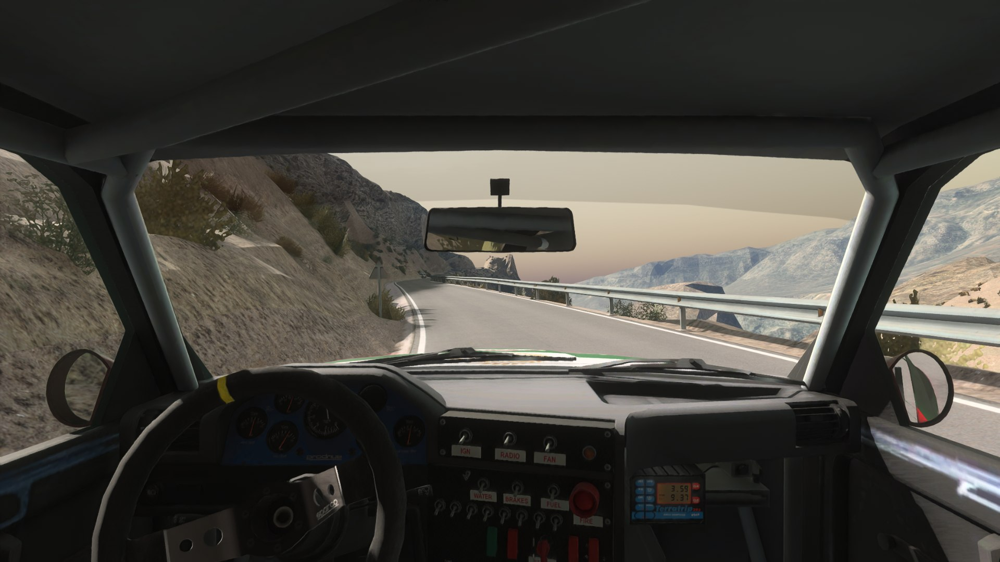
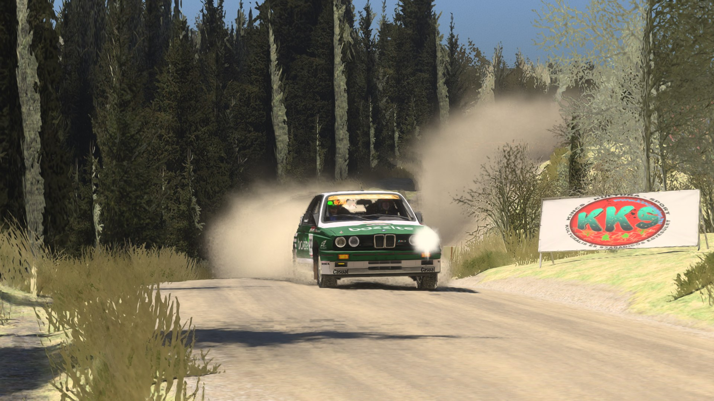

<h1 align="center">Richard Burns Rally - RTX Remix Compatibility Mod</h1>

Path tracing for **Richard Burns Rally + RallySimFans (RSF)** through NVIDIA's [RTX Remix](https://github.com/NVIDIAGameWorks/rtx-remix).

**This is not a remaster.** The mod only makes RBR readable for RTX Remix. 

**Work in progress: expect issues, and please [report them](docs/troubleshooting.md).**

## Requirements

| | |
|---|---|
| **GPU** | NVIDIA RTX card (20-series or newer) |
| **NVIDIA driver** | **572.18 or newer** (the minimum RTX Remix 1.5.2 checks for). Older drivers are not supported. |
| **Game** | Richard Burns Rally with the RallySimFans launcher, **Graphics mode = Normal** (the Vulkan, dgVoodoo and VR modes bring their own `d3d9.dll`) |
| **Must NOT be installed** | **ReShade** and the **RBR Lights Plugin**. With either one in the game, Remix will not run properly. Remove them first (for ReShade also its Vulkan layer). RBR-RTX has its own headlights, see below. |

## Installation

1. Download the latest [release](https://github.com/penkaty/RBR-RTX/releases) (`.7z` opens with [7-Zip](https://www.7-zip.org/)) and unpack it **into your RBR folder**, next to `RichardBurnsRally_SSE.exe`.
2. RSF launcher settings: **Cubic env maps off**, **Render car shadows off**, **Particles off** (Remix uses its own particle renderer). Normal or windowed 'Fullscreen mode' in the launcher is recommended.
3. Start the game. The first start compiles shaders and takes longer. **Alt+X** opens the Remix menu.
~~4. Optional: [RBR-RTX-base-mod](https://github.com/penkaty/RBR-RTX-base-mod) adds PBR materials for the original Warthog stages. Install it after RBR-RTX, the same way.~~

**Updating from 0.2 or older:** unpack over the old files, then delete `user.conf` in the RBR folder (and an edited
`rbr-rtx\config\keys.ini`). Old saved settings override the new defaults.
**Uninstall:** run `rbr-rtx\uninstall.cmd`. It removes everything RBR-RTX added; no game file was ever changed.

## Help wanted: sky, sun and weather

So far I have focused on much needed performance fixes and on cutting the unused vertex calls and draws. Still ahead
is an ungodly amount of work that can only be done in a reasonable time with the help of people willing to test it.
RBR bakes each stage's light into the scenery, so the path-traced sun has to be made to agree with the bake, stage by
stage and time of day by time of day. Nothing in the game files tells us when it does not, so **only a player looking
at the stage can tell**. From easiest to hardest:

**1. Sky textures that block the sun (easiest).** Some stages use a skybox that literally blocks the sun. Pick that
texture with the Remix dev tools (**Alt+X**) and give it the *sky texture* flag. Mention which stage it happened to me and it will be fixed in the next release.

**2. Sun position.** Stages differ in how they bake their light. RBR-RTX reads the sun direction left in the stage files
and places the Remix sun to match. Some stages will be perfectly fine. Others lack it entirely or use a straight-up 90 degree sun. For those the sun
position is automated from the chosen weather, an approximate time of day and the stage's location. This is where manual
input is needed: **every stage and time of day you set right is fixed for all players in the next release**.

**How, to set the sun position under 20 seconds**:

1. Press **`/`** for the debug sun.
2. Hold **`[`** / **`]`** to turn it around and **`;`** / **`'`** to lower / raise it until the light matches the baked shadows.
3. Press **`\`**. A windows beep confirms: that sun is kept for this stage and time of day, now and next time you drive it.
4. Send me `rbr-rtx\config\sun-saved.ini` ([GitHub issues](https://github.com/penkaty/RBR-RTX/issues)); copy it out before uninstalling.

The suns already fixed are listed in the [changelog](CHANGELOG.md). More detail: [Fixing the sun](docs/fixing-the-sun.md).

**3. Sun intensity and the weather look (hardest).** Even when the sun position fits the bake and the theme of the
stage, its intensity has to be regulated properly. There are two ways: dim and brighten the sun, which works today with
**Alt+N** / **Alt+M** (10 % per press), and enlarge it so shadows get softer, which is not in yet. The goal is a full
volumetric atmospheric weather system that matches the original raster look (heavy fog, distant haze, overcast, clear
day). In many cases the weather name alone will not give enough information, so manual input will be needed here too.

## Keybinds

Keys work while the game window is active. Every key can be changed in `rbr-rtx\config\keys.ini`; 
the full list is in [Keybinds](docs/keybinds.md).

| Key | What it does |
|---|---|
| **Alt+K** | **Stage sweep for bug reports:** hold still about 25 seconds until the beep |
| **0** | **Ray tracing on/off**, to compare with the original picture |
| 7 | Dust and tyre smoke on/off |
| **9** | **Mark a problem while driving** (beep and screenshot, keeps that stage's report) |
| **L** | **Headlights:** off, two lamps, brights (four lamps). They also switch on by themselves when the sun is low. |
| P | Ray bounces 2 (default) / 1: 1 is faster, but some heavily forested stages then show a black background behind the first two rows of trees |
| U | Distance culling on/off |
| `/` | Debug sun on/off. Then `[` `]` turn it, `;` `'` lower / raise it |
| `\` | Keep the sun now shown for this stage and time of day (beep) |
| Alt+7 | Rain and snow: Remix or the game's own |
| Alt+M / Alt+N | Sun dimmer / brighter, 10 % per press |
| Alt+P | Performance test: hold still about a minute, results go to the log |
| Alt+X | Remix's own menu (graphics settings, debug views) |

## What it does

- **Remix compatibility.** RBR draws everything with vertex shaders, which Remix cannot place in 3D. The mod rebuilds
  camera and object positions from the game's shader data and hands them to Remix.
- **Sun, sky and weather.** The Remix sun follows each stage's sun direction. RBR's sky type, clouds, time of day and
  the stage's country set Remix haze, sky light and sun strength.
- **Dynamic lights.** Includes all the vehicle lights, flashes from the exhaust backfiring and more coming soon.
- **Particles and weather.** Dust, tyre smoke, rain, snow and windscreen drops as real Remix particles; rain, snow
  and fog as closed in as the original. Tunable while driving: [Particles, rain, snow and weather](docs/particles-and-weather.md).
- **Reporting tools.** Every stage you drive is logged and zipped locally (frame rate, stutter, car, stage, PC).
  Nothing is sent anywhere.
- **A pure add-on.** It does not modify or overwrite any game files, it adds `d3d9.dll` and an `rbr-rtx\` folder and uninstalls cleanly.

Known issues are listed in [docs/known-issues.md](docs/known-issues.md). Unusual weather (snow, fog, rain, night),
rarely driven stages and Bob's Track Builder stages can look wrong.

## Documentation

| Page | Contents |
|---|---|
| [Installation](docs/installation.md) | Step by step, updating, uninstalling, RSF launcher settings |
| [Keybinds](docs/keybinds.md) | Every key |
| [Particles, rain, snow and weather](docs/particles-and-weather.md) | Dust, rain, snow, windscreen drops, fog: what the settings do and how to change them |
| [Fixing the sun](docs/fixing-the-sun.md) | Set a stage's sun and send it in |
| [Troubleshooting](docs/troubleshooting.md) | Black picture, low FPS, crashes, how to report a problem |
| [Known issues](docs/known-issues.md) | What is not working yet |
| [Remix settings for strong PCs](docs/remix-settings.md) | Raise the graphics quality if your GPU has headroom |
| [Contributing](CONTRIBUTING.md) | Reports, sun fixes, code, building from source |
| [Changelog](CHANGELOG.md) | What changed in each version, and why |

<b>Credits</b>

- [NVIDIA RTX Remix](https://github.com/NVIDIAGameWorks/rtx-remix): [dxvk-remix](https://github.com/NVIDIAGameWorks/dxvk-remix)
  runtime and Remix API header, [bridge-remix](https://github.com/NVIDIAGameWorks/bridge-remix).
- [xoxor4d](https://github.com/xoxor4d): their compatibility mods are the blueprint for this one:
  [remix-comp-base](https://github.com/xoxor4d/remix-comp-base), [p2-rtx](https://github.com/xoxor4d/p2-rtx),
  [gta4-rtx](https://github.com/xoxor4d/gta4-rtx), [l4d2-rtx](https://github.com/xoxor4d/l4d2-rtx),
  [t4-rtx](https://github.com/xoxor4d/t4-rtx), [nfsc-rtx](https://github.com/xoxor4d/nfsc-rtx) (Remix injection fix),
  [remix-comp-projects](https://github.com/xoxor4d/remix-comp-projects), the [dxvk-remix fork](https://github.com/xoxor4d/dxvk-remix)
  and [AutoPBR](https://github.com/xoxor4d/gta4-rtx-autopbr-mod).
- [mika-n / NGPCarMenu](https://github.com/mika-n/NGPCarMenu): RBR memory layout (stage, car, weather).
- [Detegr / openRBRVR](https://github.com/Detegr/openRBRVR) and [dxvk-openRBRVR](https://github.com/Detegr/dxvk-openRBRVR): how RBR renders.
- [xxHash](https://github.com/Cyan4973/xxHash) (Yann Collet): texture hashes matching Remix's.
- Other Remix mods studied: [Echelon Renderer](https://github.com/onnoj/DeusExEchelonRenderer) (onnoj),
  [D3D9DrvRTX](https://github.com/mmdanggg2/D3D9DrvRTX) (mmdanggg2), [Garry's Mod RTX Remixed](https://github.com/Xenthio/garrys-mod-rtx-remixed) (Xenthio),
  [Saints Row 3 RTX](https://github.com/PurrsianMilkman/Saints-Row-The-Third-RTX-REMIX-compatibility-mod) (PurrsianMilkman),
  gebdag's [Carmageddon 2](https://github.com/gebdag/carmageddon2-rtx-remix), [GTA2](https://github.com/gebdag/gta2-rtx-remix) and [Ignition](https://github.com/gebdag/ignition-rtx-remix),
  [Kenshi RTX](https://github.com/GARGEAN/Kenshi-RTX-Remix) (GARGEAN), [Thief Gold RTX](https://github.com/Night1099/thief-gold-rtx-remix) (Night1099),
  [Remix-Wrappers](https://github.com/Kim2091/Remix-Wrappers) and [PBRify_Remix](https://github.com/Kim2091/PBRify_Remix) (Kim2091),
  [RemixProjGroup dxvk-remix](https://github.com/RemixProjGroup/dxvk-remix), [Hooking-DX9-Present](https://github.com/bo3b/Hooking-DX9-Present) (bo3b)
- [RallySimFans](https://www.rallysimfans.hu/) for keeping RBR alive. Richard Burns Rally belongs to its owners;
  this mod contains none of its files.

MIT licence, see [LICENSE](LICENSE). RTX Remix is NVIDIA's (its licence is in `rbr-rtx\remix\LICENSE.txt`).
