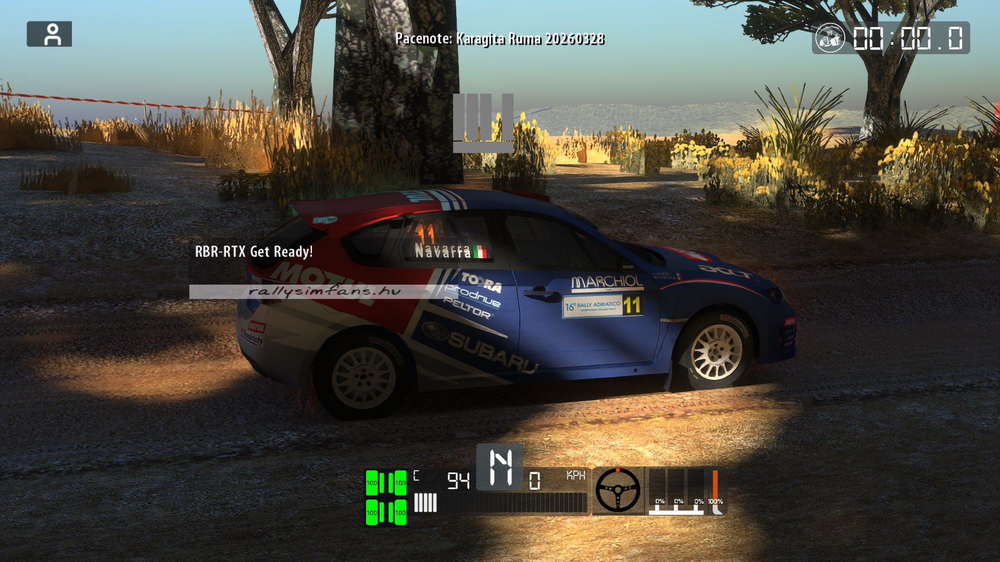

<h1 align="center">Richard Burns Rally - RTX Remix Compatibility Mod</h1>

<div align="center" markdown="1">

Made for NVIDIA's [RTX Remix](https://github.com/NVIDIAGameWorks/rtx-remix).
Works with **Richard Burns Rally + RallySimFans (RSF)**, online functionality has not been tested yet.


### This is not a remaster.
It makes the game compatible with RTX Remix so it can be path traced. The cars, stages and textures are still
the original game's.

**WIP:** RTX Remix was never meant for RBR. Crashes or broken things come from that incompatibility or from bugs in
this mod. Please report them (see [Troubleshooting](#troubleshooting)).

</div>

## Remix compatibility features

- RBR draws everything with vertex shaders, which Remix can't place in 3D on its own. I rebuild the camera and
  object positions from the game's shader data and hand them to Remix.
- Static scenery and distant trees are drawn the old fixed-function way: faster, and textures keep stable hashes.
- Remix-friendly distance culling: far geometry outside the view is left out of path tracing.
- A Remix sun that follows RBR's sun, and RBR's sky shown as the Remix sky.
- Weather and region: RBR's sky type, clouds, time of day and the stage's country set Remix haze, sky light and
  sun strength.
- Fixes for foliage cut-outs, windscreen, dust and the in-car view.
- **Alt+K stage sweep**: one key collects screenshots, Remix debug views, texture hashes and a scene capture for
  bug reports. **K** switches ray tracing off to compare with the original image.
- A pure add-on: it adds `d3d9.dll` and an `rbr-rtx\` folder, changes no game files, and uninstalls cleanly.

<div align="center">

</div>

**Not in yet: dynamic lights** (headlights, brake lights, night). RBR draws its lights as textures and bakes its
lighting into the scenery, so Remix has no lights to pick up. Each one has to be created through the Remix API
and attached to the car. That's my next big step.

<div align="center">

</div>

## Installation / Usage

1. Requirements: an NVIDIA RTX card with a recent driver, and the RSF launcher's **Graphics mode = Normal**
   (Vulkan/dgVoodoo/VR modes bring their own `d3d9.dll`).
2. Download the latest [release](https://github.com/penkaty/RBR-RTX/releases) and unpack it **into your RBR
   folder** (next to `RichardBurnsRally_SSE.exe`). `.7z` opens with [7-Zip](https://www.7-zip.org/).
3. RSF launcher: **Cubic env maps off**, **Render car shadows off**, **Particles high**. Windowed or borderless
   mode is recommended.
4. Start the game as usual. The first start compiles shaders and takes longer. **Alt+X** opens the Remix menu.
5. Uninstall: double-click `rbr-rtx\uninstall.cmd`.

You don't need any keys to drive. All keys are listed in `rbr-rtx\README.txt` and can be changed in
`rbr-rtx\config\keys.ini`.

## Troubleshooting

**Whatever the problem, run the Alt+K sweep first.** It's my main source of information for fixing things.

1. On the spot where the problem shows, stop the car and leave the camera as it is.
2. Press **Alt+K** and don't touch anything for about 25 seconds. Strange views are normal. At the end the sweep
   presses **Pause** itself for a Remix scene capture, so keep Pause free.
3. A **beep** means it's done. Quit the game and zip `rbr-rtx\logs` (plus the newest `capture_*.usd` from
   `rbr-rtx\rtx-remix\captures` if you can).
4. Send it to me with stage, car, weather and what looks wrong:
   [GitHub issues](https://github.com/penkaty/RBR-RTX/issues) or the Discord (link coming soon).

The logs contain your Windows user name and GPU model, nothing else personal. Nothing is sent automatically.

Known issues:
- **Unusual weather and rarely driven stages** (snow, fog, rain, night, custom stages) can show glowing,
  see-through or missing surfaces. Remix knows textures by hash and I haven't sorted all of them yet. A sweep from
  exactly there gives me the hashes to fix it, so logs help a lot.
- Coming from an older test build? Delete `user.conf` in the RBR folder: old Alt+X settings override the new defaults.
- Trees, dust and smoke cost a lot of FPS.
- DirectorsCut text in the interior view can be blank. With Cubic env maps on, the 3rd-person car looks wrong.
- Some modern RSF cars use shaders I don't handle yet. Please send a sweep.

## Credits

- [NVIDIA RTX Remix](https://github.com/NVIDIAGameWorks/rtx-remix): [dxvk-remix](https://github.com/NVIDIAGameWorks/dxvk-remix)
  runtime and Remix API header, [bridge-remix](https://github.com/NVIDIAGameWorks/bridge-remix).
- [xoxor4d](https://github.com/xoxor4d): their compatibility mods are the blueprint for this one:
  [remix-comp-base](https://github.com/xoxor4d/remix-comp-base), [p2-rtx](https://github.com/xoxor4d/p2-rtx),
  [gta4-rtx](https://github.com/xoxor4d/gta4-rtx), [l4d2-rtx](https://github.com/xoxor4d/l4d2-rtx),
  [t4-rtx](https://github.com/xoxor4d/t4-rtx), [nfsc-rtx](https://github.com/xoxor4d/nfsc-rtx) (Remix injection fix),
  [remix-comp-projects](https://github.com/xoxor4d/remix-comp-projects), the [dxvk-remix fork](https://github.com/xoxor4d/dxvk-remix)
  and [AutoPBR](https://github.com/xoxor4d/gta4-rtx-autopbr-mod).
- [mika-n / NGPCarMenu](https://github.com/mika-n/NGPCarMenu): RBR memory layout (stage, car, weather).
- [Detegr / openRBRVR](https://github.com/Detegr/openRBRVR) and [dxvk-openRBRVR](https://github.com/Detegr/dxvk-openRBRVR): how RBR renders.
- [xxHash](https://github.com/Cyan4973/xxHash) (Yann Collet): texture hashes matching Remix's.
- Other Remix mods I studied: [Echelon Renderer](https://github.com/onnoj/DeusExEchelonRenderer) (onnoj),
  [D3D9DrvRTX](https://github.com/mmdanggg2/D3D9DrvRTX) (mmdanggg2), [Garry's Mod RTX Remixed](https://github.com/Xenthio/garrys-mod-rtx-remixed) (Xenthio),
  [Saints Row 3 RTX](https://github.com/PurrsianMilkman/Saints-Row-The-Third-RTX-REMIX-compatibility-mod) (PurrsianMilkman),
  gebdag's [Carmageddon 2](https://github.com/gebdag/carmageddon2-rtx-remix), [GTA2](https://github.com/gebdag/gta2-rtx-remix) and [Ignition](https://github.com/gebdag/ignition-rtx-remix),
  [Kenshi RTX](https://github.com/GARGEAN/Kenshi-RTX-Remix) (GARGEAN), [Thief Gold RTX](https://github.com/Night1099/thief-gold-rtx-remix) (Night1099),
  [Remix-Wrappers](https://github.com/Kim2091/Remix-Wrappers) and [PBRify_Remix](https://github.com/Kim2091/PBRify_Remix) (Kim2091),
  [RemixProjGroup dxvk-remix](https://github.com/RemixProjGroup/dxvk-remix), [Hooking-DX9-Present](https://github.com/bo3b/Hooking-DX9-Present) (bo3b),
  [ai-modding-guides](https://gitlab.com/trevaintdead/ai-modding-guides) (trevaintdead).
- [RallySimFans](https://www.rallysimfans.hu/) for keeping RBR alive. Richard Burns Rally belongs to its owners;
  this mod contains none of its files.

## Building

```powershell
.\build.ps1 -Remix <extracted RTX Remix 1.5.2 release>     # add -Diagnostics for tester builds
.\dist\RBR-RTX\rbr-rtx\install.ps1 -Game <RBR folder>
```

Needs Visual Studio 2022 with the C++ x86 tools. `src/d3d9-proxy/` is the proxy, `package/` mirrors the game
folder's `rbr-rtx\` part, and `build.ps1` assembles `dist/RBR-RTX/` with NVIDIA's Remix runtime.
